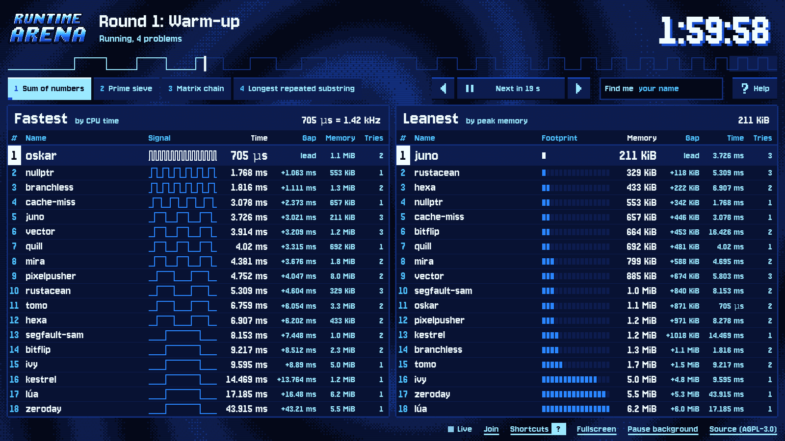

<h1 align="center"></h1>

<p align="center">
  <a href="#join-a-contest"></a>
  <a href="#host-a-contest"></a>
  <a href="#install-the-cli"></a>
  <a href="#commands"></a>
</p>

Runtime Arena is a self-hosted judge for small programming contests. Instead of
scoring who solves the most problems, it ranks correct solutions by how **fast**
and how **lean** they run.

Participants write code in any language and submit a Linux x86-64 executable or
a `#!` script with the `arena` CLI. The server runs it in an
[isolate](https://github.com/ioi/isolate) sandbox against hidden tests and
updates live CPU time and memory leaderboards, in the terminal and on a
projector page.

> **Status: v0, untested in a real event.** Run a mock contest before relying on it.

<p align="center"></p>

## Join a contest

You need the server address and event code from the organiser.

```sh
# 1. Install (Windows: see "Install the CLI")
curl -fsSL https://raw.githubusercontent.com/hugoocoto/runtime-arena/main/install.sh | sh

# 2. Create your account
arena signup https://<domain>

# If the organiser says the server uses a LAN address, run this first:
#   arena trust https://<address>
#   arena signup

# 3. Read the round and the problem
arena round
arena problem sum --samples samples

# 4. Submit, then watch the board
arena submit sum solution.py --src solution.py
arena board
```

A Python solution needs only a shebang:

```python
#!/usr/bin/env python3
import sys

numbers = map(int, sys.stdin.buffer.read().split())
next(numbers)
print(sum(numbers))
```

For compiled languages, build in the judge's environment (needs Docker) and
submit the resulting binary:

```sh
arena build -- gcc -O2 -o sol solution.c
arena build -- g++ -O2 -std=c++20 -o sol solution.cpp
arena build -- cargo build --release --bin solution   # writes target/release/solution
arena build -- env ZIG_GLOBAL_CACHE_DIR=.zig-cache zig build-exe solution.zig -O ReleaseFast -femit-bin=sol

arena submit sum sol --src solution.c
```

When `--src` points to a directory, the CLI skips the submitted executable and
recognizable ELF, Mach-O, and PE binaries. It prints the file count, archive size,
and largest included files on stderr before uploading. To submit a script that is
also your entire source, point `--src` directly at the script.

The build image is large, so download it with `arena pull` before the contest
starts. You don't need an account or any code for this.

Every server hosts a full participant guide at `https://<domain>/help`.

## Install the CLI

**Linux and macOS:**

```sh
curl -fsSL https://raw.githubusercontent.com/hugoocoto/runtime-arena/main/install.sh | sh
```

Installs to `/usr/local`, with the man page and shell completions. Set `PREFIX`
to change the location or `VERSION` to pick a release.

**Windows (PowerShell):**

```powershell
irm https://raw.githubusercontent.com/hugoocoto/runtime-arena/main/install.ps1 | iex
```

Installs to `%LOCALAPPDATA%\Programs\arena`. Both installers verify the download
checksum. Archives are on the
[releases page](https://github.com/hugoocoto/runtime-arena/releases).

## Host a contest

You need a Linux host with cgroup v2, Docker with Compose, and ports 80 and 443
reachable by participants.

> [!WARNING]
> The judge container runs **privileged** and executes untrusted binaries. Use a
> machine dedicated to the contest and read [SECURITY.md](SECURITY.md).

### 1. Deploy

```sh
git clone https://github.com/hugoocoto/runtime-arena
cd runtime-arena
cp .env.example .env && chmod 600 .env
$EDITOR .env
scripts/deploy.sh
```

Set these in `.env`:

| Setting | Value |
|---|---|
| `ARENA_ADMIN_TOKEN` | At least 24 characters: `openssl rand -hex 32` |
| `ARENA_JOIN_CODE` | Event code, at least 6 characters. Empty disables sign-up |
| `ARENA_DOMAIN` | Public DNS name, LAN IP, or `localhost` |
| `JUDGE_CPUS` | CPUs to judge on, e.g. `0,2,4,6`. One worker per CPU |
| `ARENA_VERSION` | The [latest release](https://github.com/hugoocoto/runtime-arena/releases/latest), without the `v` |

`ARENA_DOMAIN` decides how HTTPS works:

| Value | Certificate | Participants |
|---|---|---|
| Public DNS name | Let's Encrypt, automatic | `arena signup https://<domain>` |
| LAN IP | Caddy's local CA | `arena trust https://<ip>`, then `arena signup` |
| `localhost` | Caddy's local CA | Same as LAN, for rehearsals |

> [!NOTE]
> On a LAN IP, `scripts/deploy.sh` currently reports that Arena did not become
> ready, because its check doesn't trust the local CA. Confirm with
> `curl -k https://<ip>/healthz`, which should print `ok`.

With a local CA, a projector browser must also trust the certificate. Export it
and import it into that machine's trusted root certificates:

```sh
docker compose cp caddy:/data/caddy/pki/authorities/local/root.crt arena-local-ca.crt
```

For `arena trust`, give participants the SHA-256 fingerprint through a trusted
channel. Use the hex value printed after `Fingerprint=`. The fingerprint hashes
the certificate’s DER encoding, so it matches OpenSSL and browser tools.

```sh
openssl x509 -in arena-local-ca.crt -noout -fingerprint -sha256
arena trust https://<server> --fingerprint "$FINGERPRINT"
```

By default, the CLI fetches `/arena-ca.crt` over HTTP on the same host and
explicit port as the HTTPS address. If the address has no port, it uses port 80
for the download. If that route is unavailable, give the participants the
exported PEM certificate through a trusted channel and use it directly. This
works with HTTPS on any port and with an existing reverse proxy.

```sh
arena trust https://<server> --ca-file arena-local-ca.crt --fingerprint "$FINGERPRINT"
```

To serve the CA from an existing Caddy instance, add a handler to the applicable
HTTP site block. Keep only the exported public certificate in the directory
served by this handler.

```caddyfile
http://arena.local {
    handle /arena-ca.crt {
        root * /srv/arena-ca
        rewrite * /arena-local-ca.crt
        file_server
    }
    handle {
        redir https://arena.local{uri} permanent
    }
}
```

### 2. Run a round

Run these from the repository directory on the host:

```sh
arena login --admin
arena admin problem add problems/sum
arena admin round create --name "Round 1" --minutes 60 --freeze 10 sum
arena admin round start 1
```

Open `https://<domain>/` on the projector. Announce `https://<domain>/join` and
the event code.

### Keep private problem packages on the judge side

- Keep problem packages, test generators, checkers, and expected outputs on the
  organizer or judge machine. Give each contestant a clean working directory
  outside the organizer’s checkout. On shared hardware, use separate accounts
  or isolated environments with no access to the private workspace or server
  data volume.
- Before the round, run `arena admin round export 1` as the organizer. The
  archive contains `manifest.json` with limits, `<slug>/statement.md`, and
  `<slug>/samples/<name>.in` and `.out` for the declared public samples.
  Keep the archive private until the scheduled reveal, then distribute it
  from a location accessible to contestants.
- If `arena problem <slug>` fails during a round, contestants should report
  the slug and error to the organizer and use the public bundle if available.

### Before the event

```sh
scripts/host-tuning.sh                   # show settings that reduce timing noise
sudo scripts/host-tuning.sh --apply      # apply them, dedicated machines only
scripts/backup.sh /path/to/backups       # briefly pauses judging

# Simulate 20 participants. Needs cargo and Docker.
ARENA_SERVER=https://<domain> ARENA_ADMIN_TOKEN=... ARENA_JOIN_CODE=... scripts/mock-contest.sh
```

For stable timings, give `JUDGE_CPUS` one hardware thread per physical core and,
on hybrid CPUs, only performance cores. List them with `lscpu -e=CPU,CORE,MAXMHZ`.

### Update or reset

- **Update:** change `ARENA_VERSION` in `.env` and run `scripts/deploy.sh`.
- **LAN IP changed:** update `ARENA_DOMAIN` and run `scripts/deploy.sh`.
  Participants then run `arena trust https://<new-ip>`.
- **New contest, same data:** create and start a new round. Accounts and old
  rounds stay.
- **Erase everything:** back up, then run `docker compose down -v` and
  `scripts/deploy.sh`. This also creates a new local CA, so participants must run
  `arena trust` again.

## Commands

In a terminal, `arena` asks for any argument you leave out. Most list and show
commands accept `--json`, and `man arena` lists exit codes.

### Participants

| Command | Purpose |
|---|---|
| `arena trust <server> [--fingerprint <sha256>] [--ca-file <pem>]` | Trust a LAN server’s CA |
| `arena signup [server]` | Create an account and log in |
| `arena login [server]` | Log in on this device |
| `arena logout` | Log out of this device |
| `arena whoami` | Show the current account and server |
| `arena round` | Show the round, its problems and time left |
| `arena specs` | Show the judge machine (CPU, caches, memory) and how runs are timed |
| `arena problem <slug> [--samples <dir>]` | Show a statement and save samples |
| `arena pull` | Download the build image ahead of time (Docker) |
| `arena build -- <command>` | Build in the judge's environment (Docker) |
| `arena submit <problem> <executable> --src <path>` | Submit and follow judging |
| `arena submissions [id]` | List your submissions or show one |
| `arena submissions --json --refused` | Show your server-refused submission attempts, with reason codes and Unix timestamps |
| `arena board [--once\|--json]` | Open the live leaderboards, or print a snapshot |
| `arena completions <shell>` | Print a shell completion script |

### Organisers

| Command | Purpose |
|---|---|
| `arena login --admin` | Log in with the token from `.env` or the environment |
| `arena logout --admin` | Forget the saved admin token |
| `arena admin problem add <dir> [--slug <slug>] [--rejudge]` | Upload or replace a problem |
| `arena admin problem list` | List problems |
| `arena admin round create [--name] [--minutes] [--freeze] [--cooldown] <problems...>` | Create a round |
| `arena admin round list` | List rounds |
| `arena admin round start\|stop <id>` | Start or end a round |
| `arena admin round extend <id> <minutes>` | Add time to a running round |
| `arena admin round delete <id>` | Delete a draft or finished round and its submissions |
| `arena admin submissions [--round <id>]` | List submissions |
| `arena admin source <id> [-o <file>]` | Download a submission's source |
| `arena admin rejudge <id>` | Judge a submission again |
| `arena admin user list` | List participants |
| `arena admin user reset-password <name>` | Set a new password and log out their devices |
| `arena admin update` | Check for a newer server release |

## Reference

### Problem format

```
my-problem/
├── problem.toml
├── statement.md
└── tests/
    ├── 01.in
    └── 01.out
```

```toml
title = "Sum of many numbers"
time_limit_ms = 2000
memory_limit_mb = 256
samples = ["01"]       # tests shown to participants
# checker = "check.sh" # optional
```

Include a readable UTF-8 statement and both input and output files for every
declared sample. The server checks these files on upload and before starting a
round.

Output is compared token by token unless you set a `checker`. It runs as
`checker input output answer`, and exit code 0 accepts. See
[`problems/sum`](problems/sum) for an example.

### Scoring and limits

- Each participant's best accepted submission appears on each problem's time and
  memory boards.
- Each accepted test runs 3 times and the best run counts. CPU time includes all
  threads and child processes.
- Boards freeze for the last `--freeze` minutes and reveal everything at the end.
- `arena round --json` includes the active round’s aggregate judge queue.
  `arena submit --no-wait` reports how many queued jobs were ahead at intake.
  The wait estimate uses recent judging times and worker count. It estimates
  the time until judging starts.
- Participants wait 30 seconds between submissions by default (`--cooldown`).
- Executables can be up to 64 MiB and source up to 16 MiB.
- Sandboxes have no network, so multi-node MPI doesn't work. OpenMP, threads and
  child processes do.

### Optional settings

Set these in `.env`. [`.env.example`](.env.example) documents each one.

| Setting | Default | Purpose |
|---|---|---|
| `ARENA_PROCESSES` | `64` | Processes and threads per submission |
| `ARENA_MAX_FAILURES` | `3` | Stop after this many failed tests, `0` runs all |
| `ARENA_DISK_MB` | `512` | Disk space per sandbox |
| `ARENA_PORT` | `8080` | Local-only port for the admin CLI |
| `ARENA_RATE_LIMIT` | `200` | Requests per second per address, `0` disables |
| `ARENA_TRUSTED_PROXIES` | `gateway` | Proxies whose `X-Forwarded-For` names the client (Caddy, through the Docker host) |
| `ARENA_SERVER` | local | Server for `arena login --admin` from another machine |
| `ARENA_UPDATE_CHECK` | `on` | Check GitHub for new releases. Never auto-installs |
| `RUST_LOG` | `info` | Server log level |

## Development

```sh
cargo build && cargo test
scripts/sandbox-smoke.sh   # sandbox verdicts (needs Docker)
scripts/judge-tests.sh     # judge tests against real isolate (needs Docker)
scripts/e2e.sh             # short contest on the real server image (needs Docker)
```

See [CONTRIBUTING.md](CONTRIBUTING.md).

## License

[AGPL-3.0-or-later](LICENSE). If you run a modified version for others, you must
offer them its source.
